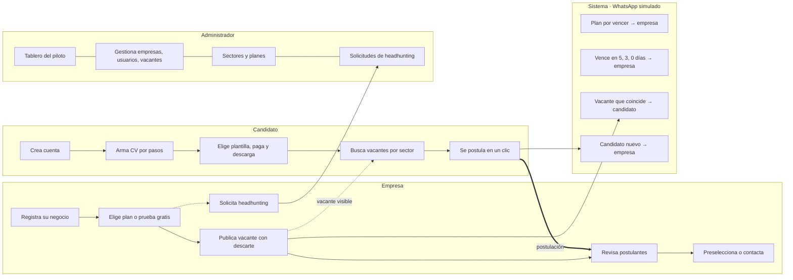
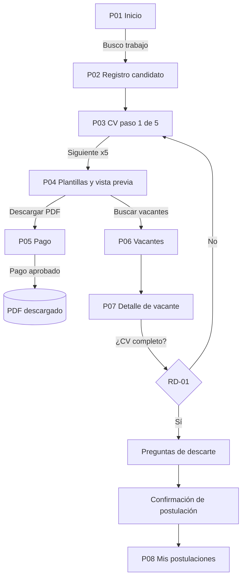
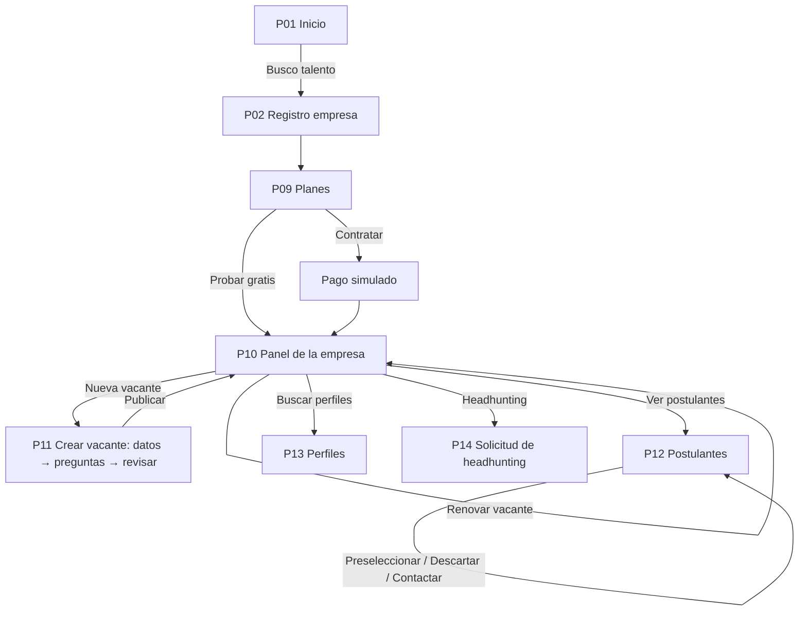
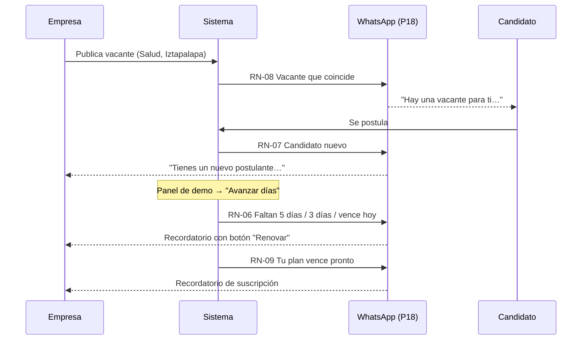
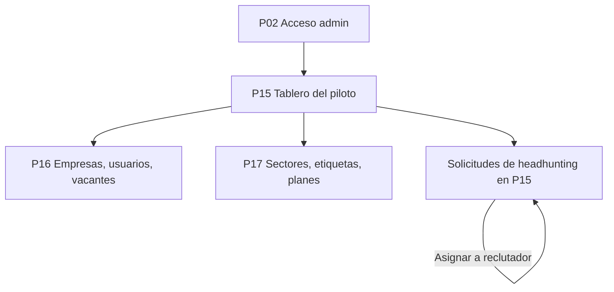

# 05 · Flujos

La empresa publica una vacante y el candidato la ve en su búsqueda. Su postulación llega a la lista de postulantes
de la empresa. Los avisos de WhatsApp acompañan cada momento y el administrador vigila el piloto desde su tablero.

## Vista general

## Flujo del candidato

## Flujo de la empresa

## Flujo del sistema (avisos)

## Flujo del administrador

